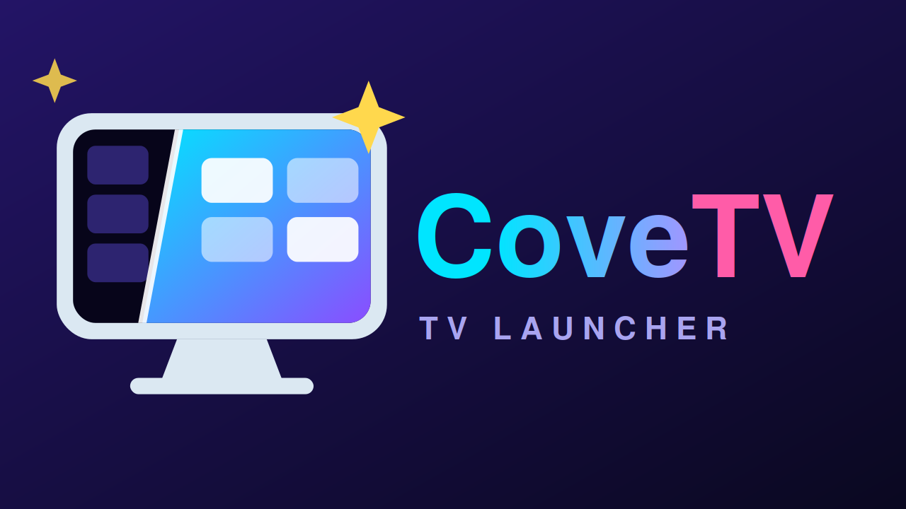

# CoveTV for Android TV

CoveTV is a customizable home launcher for Android TV and Google TV, designed for remote control.



Brand assets: [app icon](covetv-vibrant-icon-512.png) and [TV banner](covetv-vibrant-banner-320x180.png).

## Download

Get the latest APK from [Releases](https://github.com/PixelOTTO/cove-android-tv/releases/latest).
The APK keeps the same filename across releases: `CoveTV-Android-TV-launcher.apk`.

## Install

1. Download the APK on your TV, or transfer it from a computer by USB or over your home network.
2. Open the APK with a file manager. If prompted, allow that app to install unknown apps, then return and install CoveTV.
3. Open CoveTV. When Android asks which Home app to use, choose CoveTV.

If the Home prompt does not appear, open CoveTV's **Settings → TV & Launcher → Choose default home**.

This is a sideloaded APK release and is not distributed through Google Play.

### Quick start with an AI assistant

You need an Android TV or Google TV, a computer, and an AI assistant that can use the computer's terminal. For a wireless install, connect the computer and TV to the same Wi-Fi network. The assistant can guide you without terminal access, but it cannot run the install commands for you.

1. On the TV, open **Settings → About** (menu names vary by brand) and select **Build** or **Build number** seven times to show **Developer options**.
2. In **Developer options**, turn on **USB debugging**. If your TV has **Network debugging**, **ADB debugging**, or **Wireless debugging**, turn that on too. Note the TV's IP address if using Wi-Fi.
3. On the computer, open an AI assistant with terminal access and give it this prompt, replacing `<TV_IP>` with your TV's address:

   > Install CoveTV on my Android TV at `<TV_IP>`. Download the ready-made APK from https://github.com/PixelOTTO/cove-android-tv/releases/latest (the asset is named `CoveTV-Android-TV-launcher.apk`). Use Android Platform Tools and ADB; do not build from source, uninstall apps, or change unrelated TV settings. Explain the commands and ask me before installing. Wait for me to approve the debugging prompt on the TV.

4. Keep the TV on and approve **Allow USB debugging?** when it appears. When Android asks which Home app to use, choose CoveTV.

### Install manually with ADB

Install Android [SDK Platform Tools](https://developer.android.com/tools/releases/platform-tools) on the computer and download the latest release APK. The APK filename stays the same across releases.

For USB debugging, connect a USB data cable if the TV supports ADB over USB, approve the TV's debugging prompt, then run these commands from the folder containing the APK:

```sh
adb devices
adb install -r "CoveTV-Android-TV-launcher.apk"
```

`-r` updates an existing CoveTV installation while keeping its data. If ADB lists more than one device, use `adb -s DEVICE_ID install -r "CoveTV-Android-TV-launcher.apk"` with the TV's ID from `adb devices`.

Some TVs have a **Network debugging** or **ADB over network** switch that uses port 5555. If your TV shows that option, use its IP address to connect, then install:

```sh
adb connect TV_IP:5555
adb install -r "CoveTV-Android-TV-launcher.apk"
```

For **Wireless debugging**, connect the computer and TV to the same Wi-Fi network. Use the pairing address, pairing port, and code shown in the TV's Wireless debugging screen:

```sh
adb pair TV_IP:PAIRING_PORT
adb connect TV_IP:CONNECTION_PORT
adb devices
adb install -r "CoveTV-Android-TV-launcher.apk"
```

Enter the pairing code when ADB prompts. Use the separate connection port shown on the TV for `adb connect`. Wireless debugging on Android TV requires Android 13 or later. Menus and connection options vary by device; see [Android's ADB guide](https://developer.android.com/tools/adb). Turn debugging off when you're done.

## Requirements

- Android TV or Google TV
- Android 8.0 or later

## What’s included

- Customizable app grid and favorites dock
- Themes and wallpapers
- Weather and clock options
- Remote-friendly focus, motion, and highlight settings

This repository contains APK releases and install guidance. It does not currently include the application source code.

## Credits

CoveTV is an unofficial community-modified build based on [CleanYourTV](https://github.com/Gathin23/cleanyourtv) by Gathin. See [THIRD-PARTY-NOTICES.md](THIRD-PARTY-NOTICES.md) for CleanYourTV's MIT notice and [FONT-LICENSE-OFL.txt](FONT-LICENSE-OFL.txt) for the Outfit font license. CoveTV is not affiliated with or endorsed by the CleanYourTV project.

The AI-assisted install guide was informed by the setup examples in [CleanYourTV UI](https://github.com/matheus-caldeira/cleanyourtv-ui) and [Free My TV](https://github.com/simbasjungles/free-my-tv). CoveTV does not include Free My TV code.
