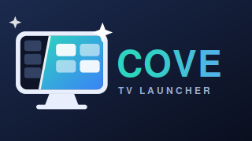

# Cove for Android TV

Cove is a customizable home launcher for Android TV and Google TV, designed for remote control.



## Download

Get the latest APK from [Releases](https://github.com/PixelOTTO/cove-android-tv/releases/latest).

## Install

1. Download the APK on your TV, or transfer it from a computer by USB or over your home network.
2. Open the APK with a file manager. If prompted, allow that app to install unknown apps, then return and install Cove.
3. Open Cove. When Android asks which Home app to use, choose Cove.

If the Home prompt does not appear, open Cove's **Settings → TV & Launcher → Choose default home**.

This is a sideloaded APK release and is not distributed through Google Play.

### Install with help from an AI assistant (ADB)

An AI assistant can guide you through installing Cove with Android Debug Bridge (ADB). To run the commands for you, the assistant also needs access to your computer's terminal and Android Platform Tools (ADB). Enabling Developer options does not give an AI access by itself; you must approve the TV's debugging prompt.

1. Download the latest Cove APK on the computer you will use to install it, and install Android [SDK Platform Tools](https://developer.android.com/tools/releases/platform-tools) so the `adb` command is available.
2. On the TV, open **Settings → About** (the exact menu varies by brand) and select **Build** or **Build number** seven times to reveal **Developer options**.
3. In **Developer options**, turn on **USB debugging**. Connect the TV to the computer with a USB data cable if the TV supports ADB over USB. When the TV asks whether to allow debugging from this computer, review the prompt and choose **Allow**.
4. Open a terminal in the folder containing the downloaded APK. Check that ADB sees the TV, then install Cove:

   ```sh
   adb devices
   adb install -r "Cove-3.1.1-Android-TV-launcher.apk"
   ```

   `-r` updates an existing Cove installation while keeping its data. If ADB lists more than one device, use `adb -s DEVICE_ID install -r "Cove-3.1.1-Android-TV-launcher.apk"` with the TV's ID from `adb devices`.

If your TV supports **Wireless debugging** instead of ADB over USB, put the computer and TV on the same Wi-Fi network, enable Wireless debugging, then use the pairing address and code shown on the TV:

```sh
adb pair TV_IP:PAIRING_PORT
adb connect TV_IP:CONNECTION_PORT
adb devices
adb install -r "Cove-3.1.1-Android-TV-launcher.apk"
```

Replace the placeholders with the matching IP address and ports shown in the TV's Wireless debugging screen. Wireless debugging on Android TV requires Android 13 or later; menus and connection options vary by device. [Android's ADB guide](https://developer.android.com/tools/adb) has the official USB and Wi-Fi steps. Turn debugging off again when the install is done.

You can ask an AI assistant: “Help me install Cove on my Android TV using ADB. The APK is in my Downloads folder. Explain each step, use only the official Android Platform Tools, and wait for me to approve the TV's debugging prompt.” After installation, press **Home** and choose Cove as the launcher.

## Requirements

- Android TV or Google TV
- Android 8.0 or later

## What’s included

- Customizable app grid and favorites dock
- Themes and wallpapers
- Weather and clock options
- Remote-friendly focus, motion, and highlight settings

This repository contains APK releases and install guidance. It does not currently include the application source code.
